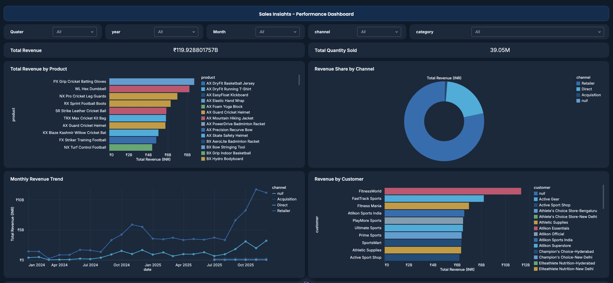
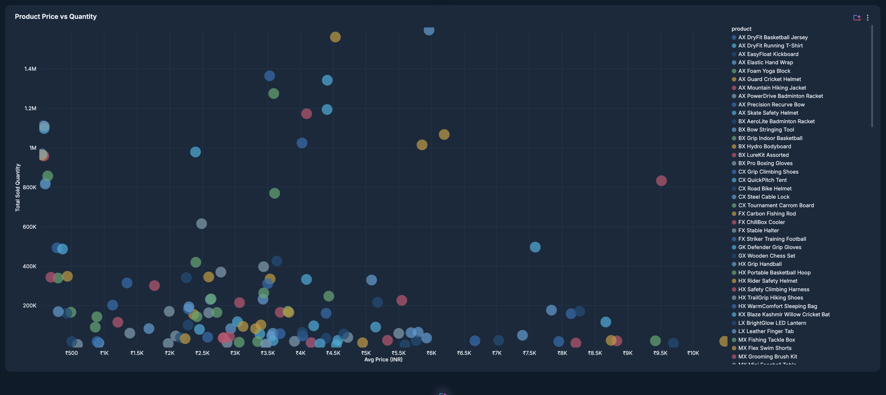

# AtliQon BI360 — End-to-End Sports Retail Analytics on Databricks

An end-to-end lakehouse project for a sports retail business (parent company **AtliQon** with a child sports-bar business): raw data lands in **AWS S3**, is ingested into **Databricks**, transformed through a **Medallion (Bronze → Silver → Gold) architecture**, and surfaced in an interactive **AI/BI dashboard** with a unified metric view.

## Architecture

```
AWS S3 (raw CSVs)
        |  COPY INTO (incremental)
        v
+---------------------------------------------+
|  Databricks Lakehouse  (catalog: fmcg)      |
|                                             |
|  Bronze  - raw, as-landed data              |
|  Silver  - cleansed & conformed tables      |
|  Gold    - star schema (fact + dims)        |
|             -> vw_fact_orders_enriched      |
|                (enriched view + metric      |
|                 definitions for BI)         |
+---------------------------------------------+
        |
        v
  AI/BI Dashboard - AtliQon BI360
  (KPIs, trends, rankings, scatter analysis)
```

## Layers

- **Bronze** — raw data landed from AWS S3, kept as-is for traceability and replay.
- **Silver** — ETL transformations: type casting, cleansing, and conforming (e.g. quantities stored as text are safely cast to numeric).
- **Gold** — star schema (`fact_orders`, `dim_date`, `dim_customers`, `dim_products`, `dim_gross_price`) plus the enriched analytics view `fmcg.gold.vw_fact_orders_enriched` that joins all dimensions and derives `total_amount_inr`.
- **Metric view** — a Unity Catalog metric view over the gold view centralizes business measures:
  - `total_revenue_inr` = `SUM(TRY_CAST(sold_quantity AS DOUBLE) * price_inr)`
  - `total_sold_quantity` = `SUM(TRY_CAST(sold_quantity AS DOUBLE))`

## Dashboard — AtliQon BI360

Interactive AI/BI dashboard (premium blue theme) with:

- **KPI counters** — Total Revenue (~INR 119.9B) and Total Quantity Sold (~39M units)
- **Revenue Share by Channel** — donut of Retailer / Direct / Acquisition
- **Monthly Revenue Trend** — revenue over time, one colored line per channel
- **Total Revenue by Product / Customer / Variant** — ranked horizontal bars
- **Product Price vs Quantity** — scatter plot (avg price vs units sold per product)
- **Filters** — quarter, year, month, channel, category

### Dashboard Preview

#### Sales Insights — Performance Dashboard



#### Product Price vs Quantity



## Repository Structure

```
├── README.md
├── assets/
│   ├── product-price-vs-quantity-dashboard.png
│   └── sales-insights-performance-dashboard.png
├── dashboard/
│   └── atliqon_bi360.lvdash.json     # AI/BI dashboard definition (importable)
├── notebooks/
│   └── utilities.py                  # schema name configuration (bronze/silver/gold)
└── sql/
    ├── 01_gold_vw_fact_orders_enriched.sql   # gold enriched view (star-schema joins)
    ├── 02_incremental_load_fact_orders.sql   # COPY INTO from S3-backed volume (incremental)
    └── 03_max_date_check.sql                 # watermark check for incremental loads
```

## Tech Stack

Databricks · Unity Catalog · Delta Lake · Medallion Architecture · SQL · AWS S3 · AI/BI Dashboards (Lakeview) · Metric Views

## Getting Started

1. Import `dashboard/atliqon_bi360.lvdash.json` into Databricks (Dashboards → Create → Import from file).
2. Recreate the gold view with `sql/01_gold_vw_fact_orders_enriched.sql`.
3. Load new data with `sql/02_incremental_load_fact_orders.sql` (adjust the volume path).
